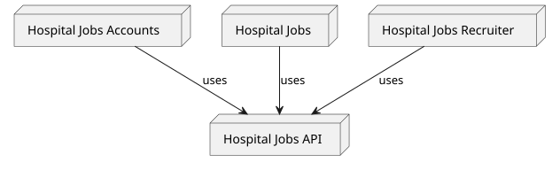
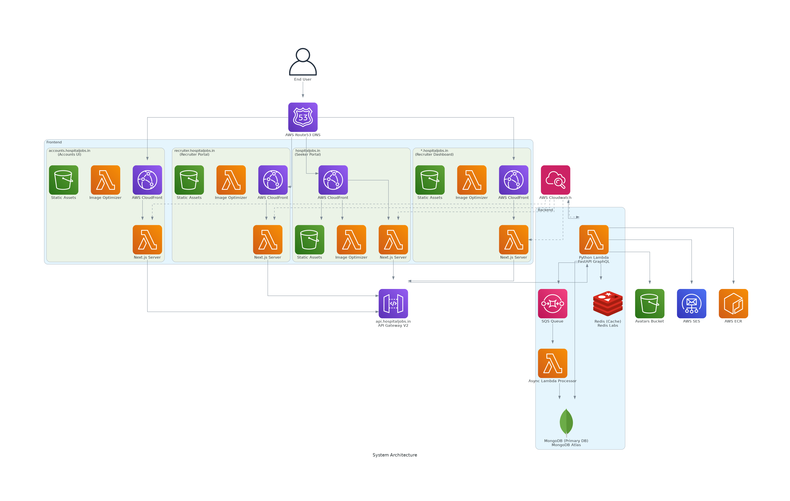

# Hospital Jobs

> _recruitment and job seeking for medical professionals_

[](https://github.com/pre-commit/pre-commit)
[](https://github.com/hospitaljobsin/hospitaljobsin/actions)
[](https://stackshare.io/hospital-jobs/hospital-jobs)


## Codebase Structure



<!--
relevant UML code:

https://www.planttext.com?text=u-LoA2v9B2efpStXvShBJqbLK0eepIbE3SylobPmJ4xEByqhALPII2nM20Xtn501bS3K6PIQN5IQMP9Q15KHnCk5nVW0Jx0qa0P90orGqDMr0t4Lh1HAYrEBGM91MCGmX1nIyrB0FW00
-->

| Service                             | Directory                                                    | Description                      |
| ----------------------------------- | ------------------------------------------------------------ | -------------------------------- |
| Hospital Jobs Accounts              | [apps/accounts](./apps/accounts)                             | Authentication/ Accounts UI      |
| Hospital Jobs Recruiter Portal Core | [apps/recruitment-portal-core](./apps/recruiter-portal-core) | Recruitment platform UI          |
| Hospital Jobs Recruiter Dashboard   | [apps/recruitment-dashboard](./apps/recruiter-dashboard)     | Recruitment platform UI          |
| Hospital Jobs                       | [apps/seeker-portal](./apps/seeker-portal)                   | Job Seeker platform UI           |
| Hospital Jobs CMS                   | [apps/cms](./apps/cms)                                       | Payload CMS Dashboard            |
| Hospital Jobs API                   | [server](./server)                                           | GraphQL API Server               |
| E2E Test Suite                      | [e2e](./e2e)                                                 | Playwright End-To-End Tests      |
| Infrastructure                      | [infrastructure](./infrastructure)                           | Terraform Infrastructure as Code |

## System Architecture



## License

This project has a proprietary license. Read the entire license [here](./README.md)

## Local development- Quickstart

### Prerequisites

| Tool                                                           | Minimum Tested Version | Description                           |
| -------------------------------------------------------------- | ---------------------- | ------------------------------------- |
| [Docker Engine](https://docs.docker.com/engine/)               | 4.35                   | Container runtime                     |
| [TMUX](https://github.com/tmux/tmux)                           | 3.2a                   | Terminal Multiplexer                  |
| [Tmuxinator](https://github.com/tmuxinator/tmuxinator)         | 3.0                    | TMUX session manager                  |
| [Terraform](https://github.com/hashicorp/terraform)            | v1.12.1                | Infrastructure as Code tool           |
| [Watchman](https://facebook.github.io/watchman/)               | 20250525.093350.0      | File watching service                 |
| [Relay Compiler](https://www.npmjs.com/package/relay-compiler) | 19.0.0                 | GraphQL Codegen Toolkit               |
| [Pre-Commit](https://pre-commit.com/)                          | 4.2.0                  | Git Hooks Framework                   |
| [MKCert](https://mkcert.dev/)                                  | 1.4.4                  | Locally trusted certificate generator |

Go through the setup guides of the services above, which covers installation of required dependencies,
and other service specific setup tasks.

#### 1. Setup Pre-Commit

To set up the git hook scripts, run the following command:

```bash
pre-commit install
```

#### 2. Setup Locally Trusted SSL Certificates

First, create a directory for your certificates and run mkcert to generate them:

```bash
mkcd certs
mkcert -install
mkcert -cert-file ./localtest.me.pem -key-file ./localtest.me-key.pem "localtest.me" "*.localtest.me"
```

This will generate:

- A certificate: `localtest.me.pem`

- A private key: `localtest.me-key.pem`

These are signed by a locally installed Root Certificate Authority (CA).

> ⚠️ Note: While this certificate is trusted within WSL and some development tools, browsers on Windows (Chrome, Edge, Firefox) won’t trust it until the Root CA is added to Windows’ trust store.

To make Windows-based browsers trust the generated certificate:

Open the mkcert CA root directory in Windows File Explorer:

```bash
cd "$(mkcert -CAROOT)"
explorer.exe .
```

- Locate the `rootCA.pem` file (you may need to rename it to `rootCA.crt` for compatibility).
- Double-click the file to open the Certificate Information window.
- Click "Install Certificate…".
- Choose “Local Machine” (requires admin access) or “Current User”.
- Select:
  - Place all certificates in the following store
  - Click Browse
  - Choose Trusted Root Certification Authorities
- Complete the wizard by clicking Next → Finish.
- Restart your browser(s) for the changes to take effect.

#### 3. Run Development Services

To start all services in development, run the following command:

```bash
tmuxinator start medical_jobs
```

### Running E2E tests

1. Stop the currently running services:
   ```bash
   tmuxinator stop medical_jobs
   ```
2. Start the docker compose E2E services:

   ```bash
   docker compose -f docker-compose.e2e.yml up --wait --build --remove-orphans -d
   ```

3. Run the E2E tests:
   ```bash
   cd e2e
   pnpm run test
   ```

## Cloud deployment

Follow these steps to deploy the project to the cloud:

### 1. MongoDB Atlas Setup

- [Install the MongoDB Atlas CLI](https://www.mongodb.com/docs/atlas/cli/current/install-atlas-cli/)
- Setup Payment Method
- Copy the MongoDB Organization ID from the dashboard and store it in environment variables
- Run the follow commands to generate API keys:
  ```bash
  atlas organizations apiKeys create --role ORG_OWNER --desc "My API Key" --orgId <ORG_ID> --output json
  ```

### 2. AWS Account Setup

- [Log in to the AWS Management Console](https://console.aws.amazon.com/)
- Create a new AWS account/ log into an existing account
- Create a new IAM user (to be used by terraform)
- Add the `"arn:aws:iam::aws:policy/AdministratorAccess"` managed IAM policy to the user

<!--
- Attach the following permissions (inline policy) to the IAM user:
```json
{
	"Version": "2012-10-17",
	"Statement": [
		{
			"Effect": "Allow",
			"Action": [
				"ecr:*",
				"logs:*",
				"acm:DeleteCertificate",
				"sts:GetCallerIdentity",
				"iam:ListInstanceProfilesForRole",
				"iam:CreateRole",
				"iam:GetRole",
				"iam:ListRolePolicies",
				"iam:ListAttachedRolePolicies",
				"iam:ListPolicyVersions",
				"iam:AttachRolePolicy",
				"iam:DeleteRole",
				"iam:PassRole",
				"iam:CreateUser",
				"iam:TagUser",
				"iam:CreatePolicyVersion",
				"iam:CreatePolicy",
				"iam:GetUser",
				"iam:DeleteUser",
				"iam:DeletePolicy",
				"iam:TagPolicy",
				"iam:ListGroupsForUser",
				"iam:ListAttachedUserPolicies",
				"iam:ListAccessKeys",
				"iam:CreateAccessKey",
				"iam:AttachUserPolicy",
				"iam:GetPolicy",
				"iam:GetPolicyVersion",
				"iam:PutRolePolicy",
				"iam:GetRolePolicy",
				"iam:DeleteRolePolicy",
				"iam:DetachUserPolicy",
				"iam:CreateServiceLinkedRole",
				"ses:*",
				"secretsmanager:*",
				"s3:*",
				"geo:CreatePlaceIndex",
				"geo:DeletePlaceIndex",
				"geo:DescribePlaceIndex",
				"acm:RequestCertificate",
				"acm:DescribeCertificate",
				"acm:ListTagsForCertificate",
				"lambda:*",
				"ec2:*",
				"route53:CreateHostedZone",
				"route53:GetHostedZone",
				"route53:ListTagsForResource",
				"route53:ListResourceRecordSets",
				"route53:ChangeResourceRecordSets",
				"route53:GetChange",
				"route53:DeleteHostedZone",
				"route53:ChangeTagsForResource",
				"apigateway:*",
				"cloudfront:UpdateDistribution"
			],
			"Resource": "*"
		}
	]
}
``` -->

- Create Access Keys for the user (choose access key for CLI, SDK, & API access)

### 3. Google Oauth2 Setup

- [Go to the google cloud console](https://console.cloud.google.com/)
- Create/ select a new project
- Configure the Oauth consent screen
- Go to "APIs & Services" > "Credentials", and create new Oauth 2.0 Credentials
- While creating the credentials, fill in the following information:

  - **Client config:**

    - _Authorized Javascript origins:_
      - https://accounts.hospitaljobs.in
      - https://hospitaljobs.in
    - _Authorized Redirect URIs:_
      - https://api.hospitaljobs.in/auth/callback/signin/google
      - https://api.hospitaljobs.in/auth/callback/request_sudo_mode/google

  - **Project Branding config:**

    - _App name:_ Hospital Jobs
    - _App Domain:_
      - _Application home page:_ https://hospitaljobs.in
      - _Application privacy policy link:_ https://hospitaljobs.in/privacy
      - _Application terms of service link:_ https://hospitaljobs.in/terms
    - _Authorized domains:_
      - hospitaljobs.in

  - **OAuth Consent Screen Configuration:**
    - Under "Scopes", add the following scope:
      - `https://www.googleapis.com/auth/user.phonenumbers.read`
    - Request verification for your OAuth app to ensure compliance with Google's policies

### 4. Cloudflare Setup

- [Go to the Cloudflare dashboard](https://dash.cloudflare.com/)
- Login to your cloudflare account
- Under Manage Account / Account tokens, click on "Create Token"

### 5. GitHub Setup

- [Go to GitHub developer settings](https://github.com/settings/tokens)
- Create a new GitHub access token with permissions for the current repository:
  - _secrets: read and write_
  - _variables: read and write_
  - _administration: read and write_

### 6. Sentry Setup

- Create a new organization
- [Install the Sentry GitHub Integration](https://docs.sentry.io/organization/integrations/source-code-mgmt/github/#installing-github) (repository linking is automated)
- [Create a Sentry Authentication Token](https://docs.sentry.io/organization/integrations/integration-platform/internal-integration/#auth-tokens) (via an internal integration)

### 7. Redis Cloud Setup

- Go to the [Redis Cloud Console](https://console.redis.io)
- Configure a payment method
- Enable programmatic access to the cloud console (Under Access Management > API Keys)
- Create an API key (AKA Secret Key)
- Copy the Account Key (AKA Access Key) and API Key (AKA Secret Key)

### 8. PostHog Setup

- Go to the [PostHog Console](https://app.posthog.com)
- Create a new project
- Copy the project API key and host

### 9. Whatsapp Business Setup

To set up a WhatsApp Business API account using Meta's developer tools, follow these updated instructions based on the latest Meta documentation. The process involves creating a Meta Developer Account, setting up a WhatsApp Business Account, and configuring the necessary components for API access.

1. **Create a Meta Developer Account**

   - Visit the [Meta for Developers](https://developers.facebook.com/) website.
   - Sign in with your Facebook account or create a new one. If you don’t have a Facebook account, you’ll need to create one.
   - Once logged in, register as a developer by following the prompts to set up your Meta Developer Account.

2. **Access the Meta Business Manager**

   - Go to [Meta Business Manager](https://business.facebook.com).
   - If you don’t have a Business Manager account, click **Create Account** and follow the steps to set up a new business account.
   - Provide the required business details (e.g., business name, address, and contact information).
   - Once created, note down the **Business Manager ID** (found in the Business Settings under **Business Info**).

3. **Create a System User in Business Manager**

   - In the Meta Business Manager, navigate to **Settings** > **Business Settings** > **Users** > **System Users**.
   - Click **Add** to create a new system user.
   - Assign a name to the system user and select the **Admin** role for full access to WhatsApp-related assets.
   - Save the system user and generate an access token later in the process.

4. **Create a New Meta App in the Developer Portal**

   - Go to the [Meta for Developers](https://developers.facebook.com/apps/) portal.
   - Click **Create App**, select **Business** as the app type, and provide the required details (e.g., app name and contact email).
   - Once the app is created, go to the app’s dashboard and add the **WhatsApp** product by clicking **Set Up** under the WhatsApp option.

5. **Assign the App to the System User and Generate an Access Token**

   - In Business Manager, go to **Settings** > **Business Settings** > **Users** > **System Users**.
   - Select the system user created in Step 3.
   - Click **Assign Assets**, choose the app created in Step 4, and assign the appropriate permissions (e.g., **Manage App**).
   - Click **Generate New Token**, select the app, and ensure all WhatsApp-related permissions are enabled (e.g., `whatsapp_business_management`, `whatsapp_business_messaging`).
   - Copy the **System User Access Token** and store it securely, as it will be used for API authentication.

6. **Set Up a WhatsApp Business Account**

   - In the Meta Business Manager, navigate to **Settings** > **Business Settings** > **Accounts** > **WhatsApp Accounts**.
   - Click **Add** to create a new WhatsApp Business Account.
   - Follow the prompts to link it to your Business Manager account. This may involve verifying your business details.

7. **Add a Phone Number to the WhatsApp Business Account**

   - In the WhatsApp Accounts section of Business Manager, select the newly created WhatsApp Business Account.
   - Click **Add Phone Number** and provide a phone number that hasn’t been used with WhatsApp before (it cannot be linked to an existing WhatsApp account).
   - Verify the phone number via SMS or voice call as prompted.
   - Configure the phone number settings, such as the display name and business profile details, following Meta’s guidelines.

8. **Obtain the WhatsApp Business Phone Number ID**
   - Once the phone number is added and verified, go to **Settings** > **Business Settings** > **Accounts** > **WhatsApp Accounts**.
   - Select the WhatsApp Business Account and locate the **Phone Number ID** (also called the WhatsApp Business Phone Number ID).
   - Copy the **Phone Number ID** for use in API requests.

### 10. Two Factor IN Setup

- Go to the [Two Factor IN Console](https://2factor.in)
- Create a new account
- Copy the API key

### 11. Payload CMS Setup

- TODO

### 12. Terraform Setup

#### 12.1 Prerequisites:

- Create an S3 bucket that will act as the terraform state backend

Terraform deployments are automated via GitHub Actions CI/CD.
the following GitHub actions variables and secrets need to be set to enable deployments:

GitHub Actions Variables:

- `TERRAFORM_AWS_BACKEND_BUCKET_NAME`
- `TERRAFORM_AWS_REGION`
- `CLOUDFLARE_ACCOUNT_ID`
- `MONGODB_ATLAS_ORG_ID`
- `WHATSAPP_PHONE_NUMBER_ID`
- `POSTHOG_HOST`

GitHub Actions Secrets:

- `TERRAFORM_AWS_ACCESS_KEY_ID`
- `TERRAFORM_AWS_SECRET_ACCESS_KEY`
- `CLOUDFLARE_API_TOKEN`
- `PA_TOKEN_GITHUB`
- `MONGODB_ATLAS_PRIVATE_KEY`
- `MONGODB_ATLAS_PUBLIC_KEY`
- `GOOGLE_OAUTH_CLIENT_ID`
- `GOOGLE_OAUTH_CLIENT_SECRET`
- `SENTRY_AUTH_TOKEN`
- `REDISCLOUD_SECRET_KEY`
- `REDISCLOUD_ACCESS_KEY`
- `WHATSAPP_ACCESS_TOKEN`
- `TWO_FACTOR_IN_API_KEY`
- `POSTHOG_API_KEY`

During the initial terraform deployment:

- update the domain registrar (GoDaddy/ NameCheap/ Google Domains)'s NS records to the Route 53 nameservers midway, to ensure certificate validation takes place

After automated deployment, you need to:

- Request SES production access manually on AWS
- Join the created team on sentry with your account
- Grant access to the following Models in AWS Bedrock:
  - Amazon Nova Micro V1
  - Amazon Nova Lite V1
  - Amazon Nova Pro V1
  - Amazon Titan Text Embeddings V2
